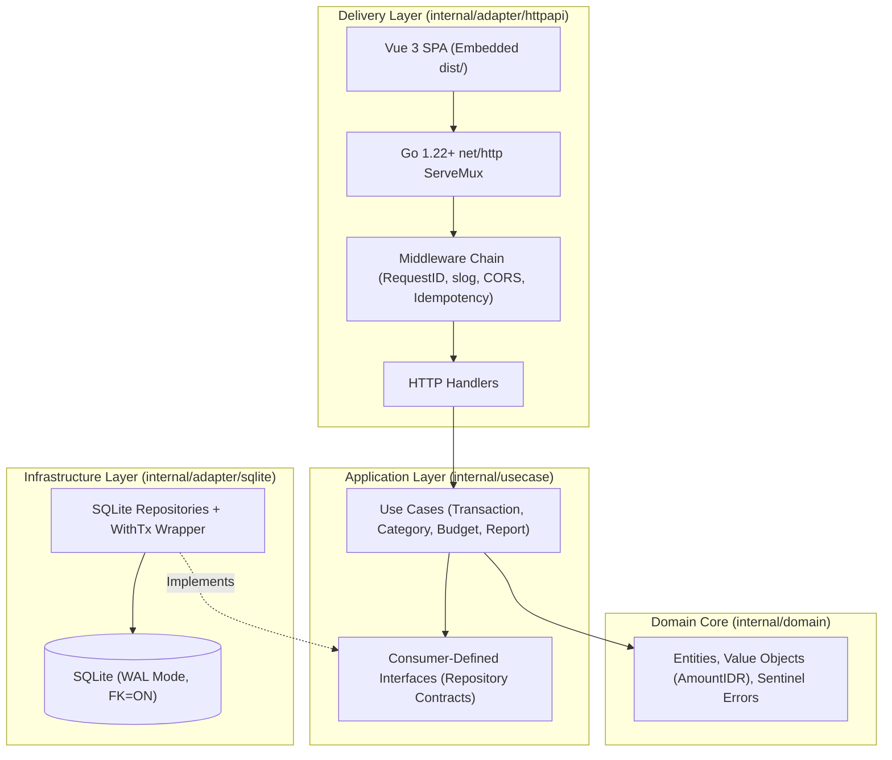

# FlowLedger — Product Requirements Document (PRD)

- **Project Name:** FlowLedger (Personal Finance Engine & Production-Grade Go Portfolio)
- **Architecture Edition:** Pragmatic Clean Architecture
- **Version:** v2.0
- **Date:** 30 October 2026
- **Author:** Randi Zakaria Putra

---

## 1. Executive Summary & Portfolio Positioning

**FlowLedger** is a high-integrity, local-first personal finance web application designed for recording income and expenses in Indonesian Rupiah (IDR), enforcing monthly category budgets, and generating deterministic financial reports. Unlike generic CRUD tutorials, v2.0 elevates FlowLedger from a basic syntax exercise into a production-grade Software Engineering portfolio artifact while strictly preserving a zero-cost, zero-external-API footprint.

> **Strategic Portfolio Goal (Why v2.0 Matters for Technical Recruiters):**
> Standard CRUD projects rarely pass mid-to-senior backend screening because they fail to demonstrate concurrency control, financial data integrity, or architectural decoupling. FlowLedger v2.0 showcases idiomatic Go 1.22+ standard library mastery, Clean Architecture, double-spend/idempotency protection, SQLite WAL tuning, and concurrent worker pipelines.

---

## 2. Goals, Non-Goals, and Target Users

### Target Users
1. Individuals tracking daily cash flow and monthly budgets in IDR.
2. Full-stack developers transitioning from PHP/Laravel to idiomatic Go.
3. Technical hiring managers evaluating backend engineering rigor via a live Read-Only/Demo Sandbox.

### Product Goals
- Record transactions in `< 15 seconds`.
- Guarantee 100% deterministic integer IDR math.
- Provide sub-50ms dashboard aggregations.
- Support memory-safe streaming CSV exports.
- Ship a single self-contained binary with embedded frontend assets (`embed.FS`).

### Engineering & Learning Goals
- Master Go 1.22+ `net/http` routing and middleware chaining.
- Implement Clean Architecture with Consumer-Defined Interfaces.
- Apply Functional Options, SQLite WAL concurrency tuning, and `context.Context` propagation.
- Build an `Idempotency-Key` middleware and concurrent query execution using `errgroup`.

### Non-Goals (MVP)
- Third-party bank syncing or payment gateway integration.
- OCR receipt scanning or LLM/AI categorization.
- Multi-currency forex conversion.
- Native mobile apps (iOS/Android).

### System Constraints
- **Zero paid services**; local-first and self-hostable.
- **Frontend:** Vue 3 + Vite + Tailwind CSS.
- **Backend:** Go 1.22+ standard library HTTP server (`net/http`). No heavy web frameworks (no Gin/Fiber/Echo in core).
- **Database:** Pure-Go SQLite (`modernc.org/sqlite`, `CGO_ENABLED=0`).

---

## 3. Core User Journeys

1. **J1 · Zero-Config First Run / Demo Mode:**
   User runs binary (or opens Demo Sandbox) $\rightarrow$ auto-migrations execute $\rightarrow$ system seeds realistic IDR categories & sample transactions (if `--seed` or `--demo` flag enabled) $\rightarrow$ dashboard renders immediate insights.
2. **J2 · Idempotent Transaction Recording:**
   User submits expense (`amount`, `category`, `date`, `note`) with client-generated `Idempotency-Key` $\rightarrow$ backend validates domain invariants inside an atomic DB transaction $\rightarrow$ updates balance & budget utilization without double-posting on network retry.
3. **J3 · Concurrent Monthly Analytics:**
   User selects month (`YYYY-MM`) $\rightarrow$ backend executes parallel queries via `errgroup` (cash flow summary, category breakdown, budget alerts, MoM delta) $\rightarrow$ returns unified response in a single round-trip.
4. **J4 · Proactive Budget Guardrails:**
   User sets monthly expense limit per category $\rightarrow$ system computes spent, remaining, and utilization % $\rightarrow$ triggers visual warning at $\ge 80\%$ (`WARNING`) and $\ge 100\%$ (`EXCEEDED`).
5. **J5 · Memory-Safe Streaming CSV Export:**
   User triggers monthly/filtered export $\rightarrow$ backend streams rows directly from SQLite cursor to `http.ResponseWriter` via `encoding/csv` without buffering the entire dataset in RAM.

---

## 4. Scope & Prioritization Matrix

| Priority / Module | Key Deliverables & Technical Requirements | Portfolio Signal |
| :--- | :--- | :--- |
| **P0 · Foundation & Runtime** | Go 1.22+ module, HTTP server with Functional Options, `/health` & `/ready` endpoints, embedded SQL migrations (`embed.FS`), SQLite WAL + Foreign Key pragmas, structured `slog` logging, graceful shutdown. | Production readiness & zero-CGO deployment |
| **P0 · Categories Domain** | List/create/update/delete categories; enforce case-insensitive uniqueness per type; block deletion of referenced categories with `HTTP 409 Conflict`. | Domain invariant enforcement & SQL constraint mapping |
| **P0 · Transactions & Idempotency** | CRUD income/expense; cursor & offset pagination; multi-field filtering; `Idempotency-Key` header middleware to prevent duplicate financial entries. | Financial system reliability & API safety |
| **P0 · Concurrent Dashboard** | Monthly totals, net cash flow, top expense categories, and MoM comparison fetched concurrently using `golang.org/x/sync/errgroup`. | Idiomatic Go concurrency with real business value |
| **P1 · Budgets & Utilization** | Upsert monthly category budget (`YYYY-MM`); compute spent, remaining, percentage used, and status state (`SAFE`, `WARNING`, `EXCEEDED`). | Complex SQL aggregation & clean business rules |
| **P1 · Streaming CSV & Single Binary** | Stream filtered transactions as RFC 4180 CSV; embed Vue 3 `dist/` folder into Go binary via `embed.FS` for single-file distribution. | Memory efficiency & DevOps packaging |
| **P2 · Recurring Scheduler & Import** | Background ticker goroutine for recurring transactions; CSV import with dry-run preview and SHA-256 row deduplication. | Background lifecycle management & batch processing |

---

## 5. Functional Rules, Domain Invariants & Acceptance Criteria

1. **Strict Integer Money Type:**
   Represent all monetary values as a custom type `type AmountIDR int64` in whole Rupiah (e.g., Rp 50.000 = `50000`). Floating-point types (`float32`/`float64`) are strictly forbidden across Go structs, SQLite columns, and JSON payloads.
2. **Transaction Integrity:**
   Required fields: `amount_idr > 0`, valid ISO-8601 date (`YYYY-MM-DD`), existing `category_id`, explicit `type` (`income` | `expense`), optional `note` ($\le 500$ runes, trimmed). Reject unknown JSON fields via `json.Decoder.DisallowUnknownFields()`.
3. **Cross-Entity Type Consistency:**
   A transaction of type `expense` **MUST** reference a category of type `expense` (and vice versa for `income`). Enforced at the domain/usecase layer and verified within a database transaction before insert/update.
4. **Sign Convention:**
   Expenses are stored as positive integers (`amount_idr > 0`). Directionality is governed strictly by the `type` field.
   $$\text{Monthly Net Cash Flow} = \sum \text{Income} - \sum \text{Expense}$$
5. **Budget Rules:**
   Budgets apply exclusively to `expense` categories per calendar month (`YYYY-MM`). Setting a budget on an `income` category returns `HTTP 422 Unprocessable Entity`.
   $$\text{Remaining} = \text{limit\_idr} - \text{spent\_idr}$$
   *(Remaining can be negative when over-budget).*
6. **Referential Protection:**
   Deleting a category referenced by $\ge 1$ transaction or budget is blocked by SQLite `ON DELETE RESTRICT` and mapped cleanly to `HTTP 409 Conflict`.
7. **Deterministic Ordering:**
   Transaction list APIs sort by `occurred_on DESC, id DESC` to guarantee stable pagination even when multiple transactions occur on the same date.
8. **RFC 9457 Problem Details Error Contract:**
   All `4xx`/`5xx` responses return standardized JSON error payloads containing `type`, `title`, `status`, `detail`, `instance`, and field-level `validation_errors[]`.
9. **CSV Injection Defense:**
   CSV export sanitizes leading formula characters (`=`, `+`, `-`, `@`) by prefixing a single quote or tab, and properly escapes commas, quotes, and newlines.

---

## 6. Clean Architecture & Idiomatic Go Design Patterns

To align with industry Go standards (Google & Uber Go Style Guides), FlowLedger uses a pragmatic Clean/Hexagonal Architecture without over-engineering:



### Package Layout & Responsibilities

| Package Path | Layer Responsibility | Applied Go Design Patterns |
| :--- | :--- | :--- |
| `cmd/flowledger/` | Application entry point: parses env/flags, wires dependencies, starts HTTP server, manages OS signals (`SIGINT`/`SIGTERM`) for graceful shutdown. | Composition Root, Graceful Lifecycle |
| `internal/domain/` | Pure business entities (`Transaction`, `Category`, `Budget`, `AmountIDR`), value objects, sentinel errors (`ErrNotFound`, `ErrConflict`, `ErrTypeMismatch`). Zero external imports. | Domain-Driven Core, Sentinel Errors, Zero-Value Usefulness |
| `internal/usecase/` | Application business rules, transaction orchestration, concurrent report aggregation. Defines small consumer interfaces (e.g., `TransactionStore`) right where they are used. | Consumer-Defined Interfaces (DIP), `errgroup` Fan-Out |
| `internal/adapter/httpapi/` | Go 1.22+ `net/http` `ServeMux` routes, request decoding, response encoding, RFC 9457 error mapper, and middleware chain (`RequestID`, `Logger`, `Recoverer`, `CORS`, `Idempotency`). | Adapter Pattern, Middleware Chaining, Functional Options |
| `internal/adapter/sqlite/` | `database/sql` repository implementations, connection pool tuning, pragma initialization, atomic transaction runner (`WithTx`), and SQL migrations. | Repository Pattern, Closure Transaction Wrapper |
| `web/` (Embedded) | Vue 3 + TypeScript + Tailwind CSS SPA compiled and embedded into the Go binary via `//go:embed dist/*`. | Single-Binary Asset Embedding |

### SQLite Production Tuning (Mandatory Connection Pragmas)

Every SQLite connection initialized by `internal/adapter/sqlite` must execute the following `PRAGMA` statements upon connection creation to prevent `SQLITE_BUSY (database is locked)` errors and enforce data integrity:

```sql
PRAGMA journal_mode = WAL;          -- Enables concurrent reads while writing
PRAGMA synchronous = NORMAL;        -- Safe durability with high write throughput in WAL mode
PRAGMA foreign_keys = ON;           -- Enforces referential integrity per connection
PRAGMA busy_timeout = 5000;         -- Waits up to 5s on write lock contention instead of failing immediately
```

---

## 7. Database Schema & Data Model

```sql
CREATE TABLE categories (
    id INTEGER PRIMARY KEY AUTOINCREMENT,
    name TEXT NOT NULL,
    type TEXT NOT NULL CHECK(type IN ('income', 'expense')),
    created_at TEXT NOT NULL,
    UNIQUE(name COLLATE NOCASE, type)
);
CREATE INDEX idx_categories_type ON categories(type);

CREATE TABLE transactions (
    id INTEGER PRIMARY KEY AUTOINCREMENT,
    category_id INTEGER NOT NULL REFERENCES categories(id) ON DELETE RESTRICT,
    type TEXT NOT NULL CHECK(type IN ('income', 'expense')),
    amount_idr INTEGER NOT NULL CHECK(amount_idr > 0),
    occurred_on TEXT NOT NULL, -- YYYY-MM-DD
    note TEXT NOT NULL DEFAULT '',
    created_at TEXT NOT NULL,
    updated_at TEXT NOT NULL
);
CREATE INDEX idx_tx_occurred_id ON transactions(occurred_on DESC, id DESC);
CREATE INDEX idx_tx_cat_occurred ON transactions(category_id, occurred_on);
CREATE INDEX idx_tx_month_type ON transactions(substr(occurred_on, 1, 7), type);

CREATE TABLE budgets (
    id INTEGER PRIMARY KEY AUTOINCREMENT,
    category_id INTEGER NOT NULL REFERENCES categories(id) ON DELETE RESTRICT,
    month TEXT NOT NULL, -- YYYY-MM
    limit_idr INTEGER NOT NULL CHECK(limit_idr > 0),
    updated_at TEXT NOT NULL,
    UNIQUE(category_id, month)
);
CREATE INDEX idx_budgets_month ON budgets(month);

CREATE TABLE idempotency_keys (
    key TEXT PRIMARY KEY,
    request_hash TEXT NOT NULL,
    status_code INTEGER NOT NULL,
    response_body BLOB NOT NULL,
    created_at TEXT NOT NULL
);
CREATE INDEX idx_idem_created ON idempotency_keys(created_at);
```

---

## 8. REST API Contract (v1) — Go 1.22+ ServeMux

| Method & Endpoint | Success | Error Codes | Description & Payload Highlights |
| :--- | :--- | :--- | :--- |
| `GET /health`<br>`GET /ready` | `200 OK` | `503 Unavailable` | Liveness and Readiness probes (verifies SQLite ping & migration version). |
| `GET /api/v1/categories` | `200 OK` | `400 Bad Request` | Lists all categories; optional `?type=income\|expense` filter. |
| `POST /api/v1/categories` | `201 Created` | `400, 409, 422` | Creates category `{name, type}`. Returns `409` if duplicate (case-insensitive). |
| `PATCH /api/v1/categories/{id}` | `200 OK` | `400, 404, 409` | Updates category `name`. Type mutation is disallowed once referenced. |
| `DELETE /api/v1/categories/{id}` | `204 No Content` | `404, 409 Conflict` | Deletes category if unreferenced; returns `409` if linked to transactions/budgets. |
| `GET /api/v1/transactions` | `200 OK` | `400 Bad Request` | Paginated list (`?month=YYYY-MM&type=&category_id=&q=&page=1&limit=20`). |
| `POST /api/v1/transactions` | `201 Created` | `400, 404, 409, 422` | Creates transaction. Supports optional `Idempotency-Key` header. |
| `GET /api/v1/transactions/{id}` | `200 OK` | `404 Not Found` | Retrieves single transaction with embedded category summary. |
| `PATCH /api/v1/transactions/{id}` | `200 OK` | `400, 404, 422` | Partial update of `amount_idr`, `category_id`, `occurred_on`, or `note`. |
| `DELETE /api/v1/transactions/{id}` | `204 No Content` | `404 Not Found` | Deletes transaction and immediately reflects in subsequent report queries. |
| `GET /api/v1/reports/monthly` | `200 OK` | `400 Bad Request` | Requires `?month=YYYY-MM`. Concurrent summary: income, expense, net, MoM %, breakdown. |
| `GET /api/v1/budgets` | `200 OK` | `400 Bad Request` | Requires `?month=YYYY-MM`. Lists budgets with `spent_idr`, `remaining_idr`, `utilization_pct`. |
| `PUT /api/v1/budgets/{category_id}/{month}` | `200 OK` | `400, 404, 422` | Idempotent upsert of monthly `limit_idr` for an expense category. |
| `GET /api/v1/transactions/export.csv` | `200 OK` | `400 Bad Request` | Streams RFC 4180 CSV with `Content-Disposition` attachment header. |

### Standardized Error Response (RFC 9457 Problem Details)

```json
{
  "type": "https://flowledger.dev/errors/validation-failed",
  "title": "Unprocessable Entity",
  "status": 422,
  "detail": "Transaction validation failed on one or more fields.",
  "instance": "/api/v1/transactions",
  "validation_errors": [
    {
      "field": "amount_idr",
      "reason": "must be a positive integer greater than 0"
    }
  ]
}
```

---

## 9. Frontend Screens & UX Specifications (Vue 3 + Tailwind)

- **Global Quick-Add Bar & Keyboard Shortcut:** Pressing `N` opens the Add Transaction modal from any screen with auto-focus on the IDR amount input (formatted live with thousands separators, e.g., `Rp 125.000`).
- **Executive Dashboard:** Month picker, 4 KPI cards (Total Income, Total Expense, Net Cash Flow, Savings Rate %), Category Breakdown Donut/Bar chart, and Top 3 Budget Watchlist cards.
- **Transactions Explorer:** Debounced search on notes, filter chips (Month, Type, Category), clean data table with IDR formatting, inline edit/delete confirmation, and "Export CSV" button.
- **Budgets Manager:** Visual progress bars per category with semantic color coding:
  - Emerald (`< 80%` — `SAFE`)
  - Amber (`80%–99%` — `WARNING`)
  - Rose (`>= 100%` — `EXCEEDED` / Over-Budget) with accessible text badges.
- **Demo Sandbox Banner:** When running in `APP_ENV=demo`, displays a subtle top banner: *"Live Portfolio Sandbox — Data resets every 24h"* with a 1-click **"Reset Demo Data"** action.

---

## 10. Security, Observability & Operational Constraints

- **HTTP Server Hardening:** Configure explicit `http.Server` timeouts: `ReadHeaderTimeout` (`5s`), `ReadTimeout` (`10s`), `WriteTimeout` (`15s`), `IdleTimeout` (`60s`), and `http.MaxBytesReader` (`1 MB` limit on JSON bodies).
- **Structured Observability:** Use Go standard library `log/slog` (JSON handler in production, tinted text in dev). Propagate `X-Request-ID` across `context.Context` and log `method`, `path`, `status`, `duration_ms`, and error cause.
- **Demo Mode Guardrails:** In public portfolio deployment (`APP_ENV=demo`), rate-limit write endpoints (token bucket per IP) and run a background cleanup goroutine that restores clean Indonesian seed data nightly.
- **Zero Secret Leakage:** Never log raw transaction notes in production logs to preserve privacy; use parameterized SQL queries exclusively.

---

## 11. Upgraded 21-Day Learning & Build Milestones

| Milestone | Core Go & Clean Code Concepts | Deliverable & Verification Exercise |
| :--- | :--- | :--- |
| **M0 · Domain Core (Days 1–2)** | Custom types (`AmountIDR`), structs, value vs pointer receivers, sentinel errors, table-driven unit tests. | Build `internal/domain` validation rules. **Exercise:** 100% test coverage on `Transaction.Validate()` and `AmountIDR` math. |
| **M1 · HTTP & Middleware (Days 3–4)** | Go 1.22 `net/http` routing, `encoding/json`, `DisallowUnknownFields`, middleware chaining, `log/slog`, `httptest`. | Build `/health`, RFC 9457 error responder, `RequestID` & Panic recovery middlewares. Test malformed JSON $\rightarrow$ `400`. |
| **M2 · SQLite & Pragmas (Days 5–6)** | `database/sql`, `modernc.org/sqlite`, `embed.FS` migrations, WAL/FK pragmas, context timeouts, `defer rows.Close()`. | Implement Category SQLite repository with case-insensitive uniqueness and `409 Conflict` mapping on FK violation. |
| **M3 · Transactions & Idempotency (Days 7–9)** | Consumer-defined interfaces, atomic DB transactions (`WithTx` closure), `Idempotency-Key` middleware. | Full Transaction CRUD + filtering + pagination. **Exercise:** prove duplicate `POST` with same `Idempotency-Key` creates 1 row. |
| **M4 · Concurrent Reporting (Days 10–11)** | `golang.org/x/sync/errgroup`, context cancellation propagation, SQL aggregate queries, integer math. | Build `GET /api/v1/reports/monthly` running 3 parallel queries. Benchmark sequential vs `errgroup` latency. |
| **M5 · Budgets & State Logic (Days 12–13)** | Upsert SQL (`ON CONFLICT DO UPDATE`), domain state calculation (`SAFE`/`WARNING`/`EXCEEDED`). | Implement Budget service & endpoints. **Exercise:** table-driven tests for `0%`, `80%`, `100%`, and `125%` budget utilization. |
| **M6 · Vue 3 SPA & Embed (Days 14–16)** | CORS middleware, TypeScript API client, `embed.FS` SPA static serving with `index.html` fallback. | Connect Vue 3 frontend to Go API and compile into a single self-contained binary. |
| **M7 · Streaming CSV & Release (Days 17–21)** | `encoding/csv` streaming, `io.Writer`, graceful shutdown (`signal.NotifyContext`), `Makefile`, GitHub Actions CI. | Implement streaming CSV export with formula sanitization, `--seed` CLI flag, and complete `README.md` architecture docs. |

---

## 12. Go Idioms vs. PHP/Laravel Mental Model (Quick Reference)

| Concept | PHP / Laravel Habit | Idiomatic Go Equivalent in FlowLedger |
| :--- | :--- | :--- |
| **Architecture & Wiring** | Service Container magic, Facades, Auto-wiring | Explicit constructor injection in `main.go` (`NewService(repo)`) |
| **Data Validation** | `FormRequest` arrays (`'amount' => 'required\|integer'`) | Explicit domain methods (`func (t *Transaction) Validate() error`) |
| **Error Handling** | Throwing & catching `Exception` across layers | Errors as values (`if err != nil { return fmt.Errorf("...: %w", err) }`) |
| **Database Access** | Eloquent ORM (Active Record magic) | Explicit SQL with `database/sql` (or `sqlc` type-safe code generation) |
| **Concurrency** | Synchronous request worker / Redis Queue | Lightweight goroutines + `errgroup` + `context.Context` cancellation |

---

## 13. Definition of Done (Production & Portfolio Checklist)

- [ ] **Functional Completeness:** All P0 and P1 endpoints, Vue 3 screens, budget guardrails, and streaming CSV export work end-to-end.
- [ ] **Code Quality & Tooling:** Zero warnings from `go vet ./...`, `staticcheck ./...`, and `golangci-lint run`. Formatted strictly with `gofmt`/`goimports`.
- [ ] **Test Rigor:** `go test -race ./...` passes with $\ge 80\%$ coverage on `internal/domain` and `internal/usecase`, using in-memory/temp-file SQLite integration tests.
- [ ] **Single-Binary Packaging:** Running `make build` produces a single zero-CGO binary containing backend, SQL migrations, and Vue 3 static assets.
- [ ] **Portfolio Documentation:** Repository includes architecture diagram (Mermaid), ADR (Architecture Decision Records), OpenAPI/Swagger spec, benchmark numbers, and `LEARNING.md`.