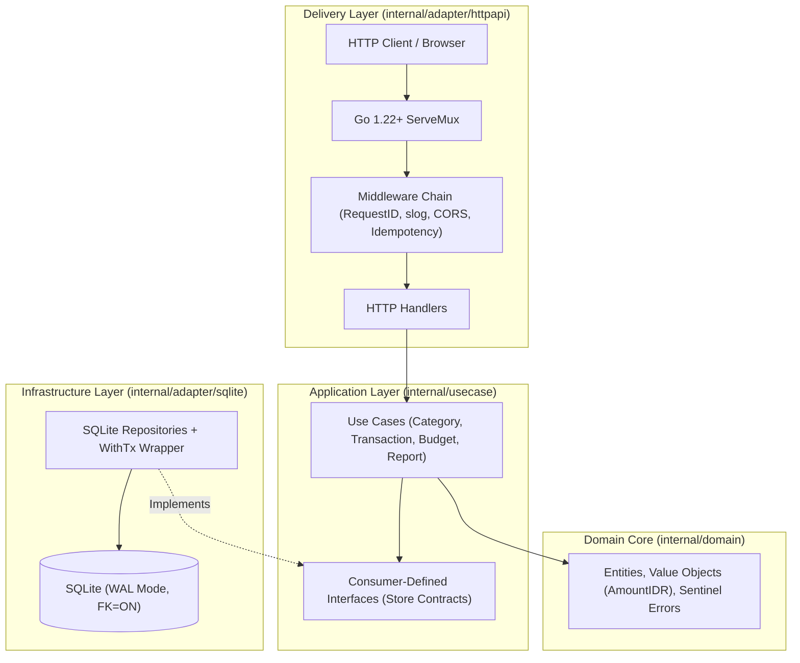

# FlowLedger — High-Integrity Personal Finance Engine

> **Architecture:** Pragmatic Clean Architecture  
> **Runtime:** Idiomatic Go 1.22+ Standard Library (`net/http`)  
> **Database:** Pure-Go SQLite (`modernc.org/sqlite`, `CGO_ENABLED=0`, WAL mode)  
> **Author:** Randi Zakaria Putra  

---

## 1. Overview & Architectural Highlights

FlowLedger is a high-integrity, local-first personal finance backend engine engineered to demonstrate production-grade Go capabilities without heavy third-party web frameworks:

- **100% Deterministic Integer IDR Math:** Zero floating-point rounding errors via [`AmountIDR`](file:///d:/Project/flowledger/backend/internal/domain/amount.go).
- **Pragmatic Clean Architecture:** Clear decoupling across Domain, Usecase, and Adapter layers using Consumer-Defined Interfaces.
- **SQLite Concurrency & WAL Tuning:** Production connection pragmas (`WAL`, `busy_timeout=5000`, `foreign_keys=ON`) preventing database locks.
- **Financial Double-Spend & Idempotency Protection:** RFC-compliant `Idempotency-Key` middleware capturing request hashes with replay caching.
- **Concurrent Report Aggregation:** Sub-50ms monthly financial analytics running parallel queries via `golang.org/x/sync/errgroup`.
- **Memory-Safe Streaming CSV Export:** RFC 4180 export streamed row-by-row directly from SQLite cursors to `http.ResponseWriter` with CSV formula injection defense.
- **RFC 9457 Problem Details Contract:** Standardized structured JSON error payloads with field-level validation breakdowns.

---

## 2. System Architecture



---

## 3. Directory Structure

```
backend/
├── cmd/
│   └── flowledger/
│       └── main.go                  # Composition Root & graceful shutdown
├── internal/
│   ├── domain/                      # Pure domain core (0 external imports)
│   │   ├── amount.go                # AmountIDR integer type & formatting
│   │   ├── category.go              # Category entity & invariants
│   │   ├── transaction.go           # Transaction entity & invariants
│   │   ├── budget.go                # Budget entity & utilization math
│   │   └── errors.go                # Domain sentinel errors & RFC 9457 errors
│   ├── usecase/                     # Application business rules
│   │   ├── category.go              # Category orchestration & store interface
│   │   ├── transaction.go           # Transaction orchestration & CSV streaming
│   │   ├── budget.go                # Monthly budget validation & upsert
│   │   └── report.go                # Concurrent errgroup monthly reporting
│   └── adapter/
│       ├── httpapi/                 # Go 1.22+ net/http ServeMux & middlewares
│       │   ├── router.go            # ServeMux registration & middleware chaining
│       │   ├── middleware.go        # RequestID, Logger, Recoverer, CORS, Idempotency
│       │   ├── response.go          # RFC 9457 Problem Details error mapper
│       │   ├── category_handler.go
│       │   ├── transaction_handler.go
│       │   ├── budget_handler.go
│       │   ├── report_handler.go
│       │   ├── export_handler.go
│       │   └── probes_handler.go
│       └── sqlite/                  # SQLite persistence & migrations
│           ├── migrations/          # Embedded SQL migrations
│           │   └── 000001_init.sql
│           ├── db.go                # DB pool, WAL pragmas & WithTx closure
│           ├── category_repo.go
│           ├── transaction_repo.go
│           ├── budget_repo.go
│           ├── idempotency_repo.go
│           ├── report_repo.go
│           └── seed.go              # Realistic Indonesian seed data
├── FlowLedger PRD.md                # Full product requirements document
├── Makefile                         # Automation commands
└── go.mod
```

---

## 4. API Endpoints (v1)

| Method & Route | Status | Description |
| :--- | :--- | :--- |
| `GET /health` | `200` | Liveness probe |
| `GET /ready` | `200` | Readiness probe verifying SQLite connectivity |
| `GET /api/v1/categories` | `200` | Lists categories (optional `?type=income\|expense`) |
| `POST /api/v1/categories` | `201` | Creates category (`409 Conflict` on case-insensitive duplicate) |
| `PATCH /api/v1/categories/{id}` | `200` | Updates category name |
| `DELETE /api/v1/categories/{id}` | `204` | Deletes category (`409 Conflict` if referenced by tx/budget) |
| `GET /api/v1/transactions` | `200` | Paginated transactions (`?month=&type=&category_id=&q=&page=&limit=`) |
| `POST /api/v1/transactions` | `201` | Creates transaction (supports `Idempotency-Key` header) |
| `GET /api/v1/transactions/{id}` | `200` | Single transaction with embedded category details |
| `PATCH /api/v1/transactions/{id}` | `200` | Partial transaction update |
| `DELETE /api/v1/transactions/{id}` | `204` | Deletes transaction |
| `GET /api/v1/transactions/export.csv`| `200` | Streams RFC 4180 CSV directly to client |
| `GET /api/v1/budgets` | `200` | Requires `?month=YYYY-MM`. Lists budgets with calculated utilization |
| `PUT /api/v1/budgets/{category_id}/{month}` | `200` | Idempotent upsert of monthly budget limit |
| `GET /api/v1/reports/monthly` | `200` | Requires `?month=YYYY-MM`. Concurrently aggregates cash flow, MoM delta, breakdown |

---

## 5. Getting Started

### Prerequisites
- Go 1.22 or newer (`modernc.org/sqlite` requires **no CGO / no gcc**).

### Run with Realistic Demo Seeding
```bash
go run ./cmd/flowledger -seed
```

### Run Tests with Statement Coverage
```bash
go test -cover ./...
```

### Build Binary
```bash
go build -ldflags="-s -w" -o bin/flowledger.exe ./cmd/flowledger
```

